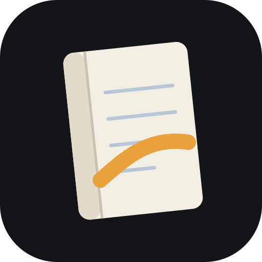
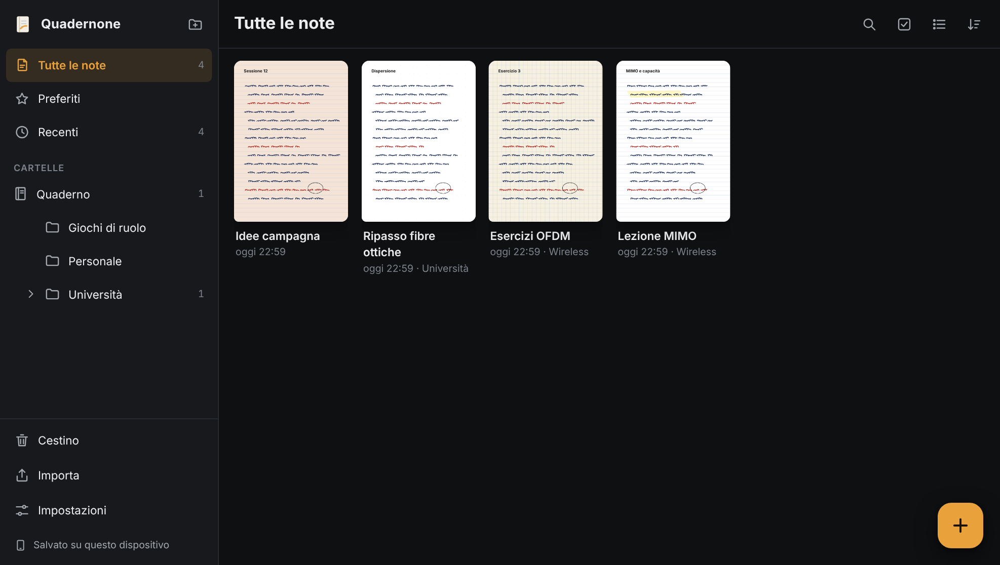
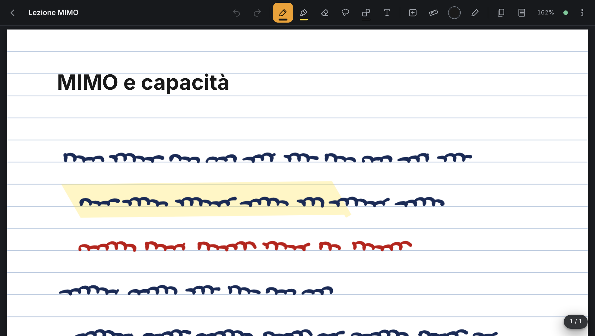

<div align="center">



# Quadernone

**Il quaderno a penna che sta sul tuo dispositivo.**
Scrivi a mano, annota PDF e slide, organizza tutto in cartelle.
Funziona senza internet; con Google Drive, se vuoi, ritrovi tutto su ogni dispositivo.

[Apri l'app](https://exire2k1.github.io/quadernone-android/) · [Guida all'installazione](LEGGIMI.md)

</div>

<p align="center">
  
  
</p>

---

## Com'è fatto

Quadernone ha **due schermate**:

- **la Libreria**, per trovare e organizzare le note;
- **l'Editor**, per scriverci dentro.

Tutto il resto (impostazioni, cestino, copertina, importazione) si apre sopra come pannello e si chiude tornando esattamente dov'eri.

È pensato prima di tutto per la **penna**: la S Pen del tablet Samsung, la penna di un portatile touch Windows o il dito sul telefono. L'interfaccia è solo scura, la carta resta carta.

## Scrivere

- **Quattro penne:**
  - **biro**, tratto uniforme;
  - **stilografica**, lo spessore segue la pressione e la direzione, come un pennino a 45°;
  - **matita**, granulosa e semitrasparente;
  - **pennarello**, largo e coprente.
- **Spessore** da 0,5 a 20 pt, con tre spessori preferiti.
- **Pressione:** si calibra da sola su ogni dispositivo, perché ogni penna la misura a modo suo.
- **Evidenziatore:**
  - sei colori fluo;
  - punta tonda o a scalpello;
  - modalità *linea dritta* per sottolineare;
  - resta sempre **sotto** l'inchiostro, così non copre ciò che hai scritto.
- **Gomma:** ad area (cancella solo dove passi) oppure a tratto intero; c'è anche *Cancella pagina*.
- **Lazo:**
  - selezione libera o a rettangolo, con filtro (tutto, solo scrittura, solo immagini, solo testo);
  - sulla selezione puoi spostare, ridimensionare, ruotare, cambiare colore e spessore, copiare, duplicare, portare avanti o indietro, spostare su un'altra pagina.
- **Forme:**
  - disegna un cerchio, un rettangolo, un triangolo o una linea e tieni ferma la punta mezzo secondo: diventa una forma perfetta, che resta modificabile;
  - oppure le inserisci direttamente (linea, freccia, rettangolo, ellisse, triangolo).
- **Righello virtuale:** lo sposti e lo ruoti con due dita, la penna traccia dritta lungo il bordo e vedi l'angolo.
- **Testo:**
  - caselle ovunque sulla pagina;
  - titoli, grassetto, corsivo, sottolineato, barrato;
  - elenchi puntati e numerati, liste di controllo;
  - colore, dimensione, allineamento.
- **Colori:** dieci colori rapidi personalizzabili, selettore completo con codice esadecimale, contagocce e gli ultimi cinque usati.

### La penna fa la penna, il dito fa il dito

- **Penna:** scrive con lo strumento scelto.
- **Dito:**
  - un dito scorre la pagina;
  - due dita spostano e fanno zoom;
  - con *Dito e penna* anche il dito scrive.
- **Palmo:** appoggiato sullo schermo mentre scrivi, viene ignorato.
- **Tasto laterale della penna:**
  - una pressione breve passa da **Penna** a **Gomma** e viceversa;
  - tenendolo premuto attivi il **Lazo** finché lo tieni;
  - la punta-gomma, se la penna ce l'ha, cancella sempre.
- **Gesti:** doppio tocco con due dita = annulla, con tre dita = ripeti.
- **Tastiera:** `Ctrl+Z` / `Ctrl+Y`, copia e incolla; `P` `H` `E` `L` `T` per penna, evidenziatore, gomma, lazo e testo; `Ctrl +` / `Ctrl −` per lo zoom.
- Almeno **100 passi di annulla** per sessione, su scrittura, oggetti, pagine e sfondi.

## Pagine

- **Formati:** A4 (predefinito), A5, Letter, verticale o orizzontale, misura personalizzata in millimetri, oppure **pagina infinita** che si allunga mentre scrivi.
- **Sfondi:** bianco, a righe, a quadretti o a puntini, con spaziatura e colore delle righe a scelta.
- **Colori della carta:** bianca, avorio, sabbia, grigia o scura (con righe chiare).
- Sfondo e formato si cambiano **per pagina o per tutta la nota**, anche dopo: la scrittura non si sposta.
- **Pannello Pagine:** miniature per saltare, trascinare e riordinare, duplicare, eliminare.
- **Nessun pulsante Salva:** ogni modifica si salva da sola dopo un istante.

## PDF, slide e immagini

- **PDF:** ogni pagina del PDF diventa una pagina della nota, su cui puoi scrivere. L'originale resta intatto tra gli allegati e puoi inserire pagine bianche tra quelle del PDF.
- **Slide `.pptx`:** diventano pagine annotabili, convertite tramite Google Drive.
- **Immagini:** da file, galleria, fotocamera o appunti. Puoi ritagliarle, ruotarle, cambiarne l'opacità, bloccarle o usarle come copertina.
- **Esporta PDF:** la nota esce come PDF con scrittura, testo e immagini sopra le pagine originali, uguale a come la vedi. Con più note esce un `.zip`.

## Libreria

- **Cartelle e sottocartelle senza limiti**, con un colore a scelta. Per spostare una nota o una cartella basta trascinarla su un'altra.
- **Viste rapide:** Preferiti, Recenti (ultimi 30 giorni), Tutte le note.
- **Visualizzazione:** griglia di copertine o elenco con la prima riga di testo. Ordinamento per modifica, creazione o nome.
- **Copertine:** automatiche (la prima pagina), da un'immagine o con colore e icona.
- **Selezione multipla** per spostare, eliminare, aggiungere ai preferiti o esportare più note insieme.
- **Ricerca** in titoli, caselle di testo e **testo dei PDF**:
  - ignora maiuscole e accenti ("perche" trova "perché");
  - mostra il brano trovato evidenziato e apre la nota alla pagina giusta;
  - filtri: solo questa cartella, solo PDF, intervallo di date.
- **Cestino:** le note eliminate restano 30 giorni (durata regolabile) e si ripristinano nella cartella di origine, anche se nel frattempo era stata cancellata.

## Dove stanno le tue note

**Sul dispositivo, prima di tutto.** Quadernone non ha un server e non ti chiede un account. Le note si salvano nell'archivio interno del browser, così l'app si apre e funziona anche in aereo o in metropolitana.

**Su Google Drive, se vuoi.** Con *Accedi con Google* nel tuo Drive compare la cartella **`Quadernone`**, con le tue cartelle e una cartella per ogni nota. Da lì le note arrivano agli altri dispositivi in pochi secondi.

```
Quadernone/
  Università/
    Wireless/
      Lezione MIMO/
        meta.json        titolo, date, preferito, copertina
        pages.json       pagine, sfondi, caselle di testo, immagini, forme
        note.md          tutto il testo della nota, in Markdown
        ink/…json        la scrittura a mano, pagina per pagina
        previews/…svg    ogni pagina come immagine
        cover.png        la copertina
        attachments/     PDF, slide e immagini originali
  _cestino/
```

- **File in chiaro e formati aperti:** le note si leggono anche senza l'app e non sono chiuse in un formato proprietario.
- **Accesso limitato:** l'app vede **solo i file che crea lei**, non il resto del tuo Drive.
- **Account separati:** ognuno usa il proprio account Google; le note di un amico non passano mai dalle tue.
- **Mai una sovrascrittura silenziosa:** se modifichi la stessa nota su due dispositivi prima che si sincronizzino, una versione diventa una **copia di conflitto**. Quadernone ti mostra cosa c'è solo nell'una e solo nell'altra e ti consiglia cosa fare: tieni l'originale, tieni la copia, **uniscile** oppure tienile entrambe.
- **Copia di sicurezza senza Drive:** *Esporta tutto (.zip)* crea un archivio con lo stesso formato di file. Si reimporta con un tocco, anche su un altro dispositivo.

## Portare le note da Samsung Notes

- **File `.sdocx`:** la scrittura a mano resta **scrittura vera**, tratto per tratto e modificabile, con PDF, immagini, testo e date originali.
- **Export in PDF o `.txt`** da Samsung Notes: i PDF diventano pagine su cui continuare a scrivere, i `.txt` caselle di testo.
- **Una cartella intera o uno `.zip`:** con *Ricrea le cartelle di origine* ritrovi la stessa organizzazione.

## Su quali dispositivi

Quadernone è una **Progressive Web App**: si apre dal browser e si **installa** come un'app vera, con la sua icona, a schermo intero e funzionante offline.

| Dispositivo | Come si usa |
|---|---|
| Tablet Android con penna (es. Samsung + S Pen) | Chrome › ⋮ › *Installa app*. Il dispositivo principale per scrivere. |
| Portatile Windows touch con penna | Chrome o Edge › icona *Installa* nella barra degli indirizzi. |
| Telefono | Chrome › *Installa app*. Pagine adattate alla larghezza, strumenti essenziali in vista. |
| PC con mouse e tastiera | Dal browser, per rileggere, organizzare ed esportare. |

L'installazione passo per passo e la configurazione di Google Drive sono in **[LEGGIMI.md](LEGGIMI.md)**.

## Sotto il cofano

- HTML, CSS e JavaScript (moduli ES) senza framework e **senza build**: i file che vedi sono quelli che girano.
- **Archivio sul dispositivo:** IndexedDB, con revisioni per nota e per pagina, cestino e registro delle modifiche, come un piccolo server che vive dentro l'app.
- **Google Drive:** Google Identity Services e l'API REST di Drive, con permesso `drive.file`.
- **Librerie incluse nel repository**, nessuna caricata da internet: [pdf.js](https://github.com/mozilla/pdf.js) per mostrare i PDF, [pdf-lib](https://github.com/Hopding/pdf-lib) per esportarli, [perfect-freehand](https://github.com/steveruizok/perfect-freehand) per i tratti, [JSZip](https://github.com/Stuk/jszip) per gli archivi. Versioni e licenze in [`vendor/VERSIONS.md`](vendor/VERSIONS.md).

<p align="center"><sub>Fatto per scrivere a mano, non per riempire moduli.</sub></p>
